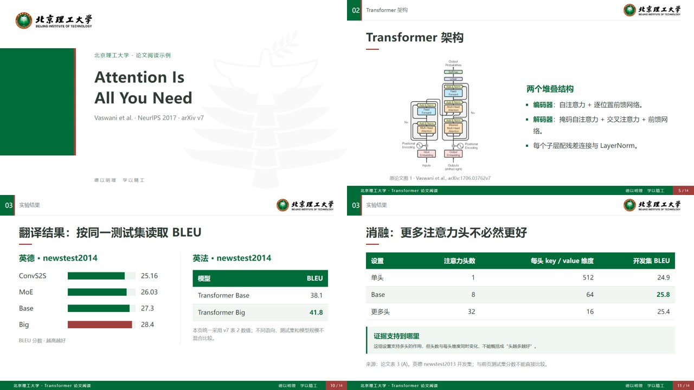
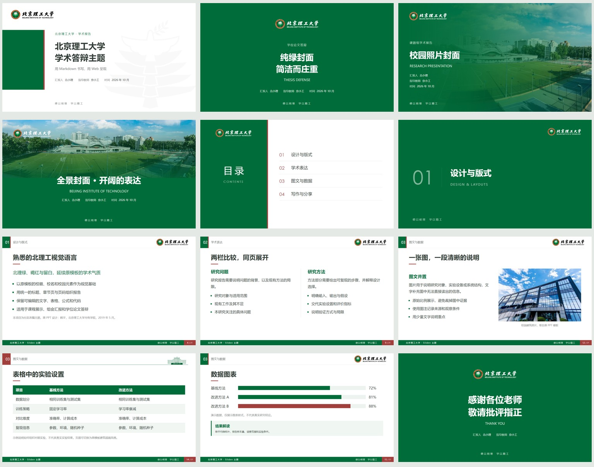

# slidev-theme-bit

[简体中文](README.md) · [English](README.en.md)

**北京理工大学 Slidev 学术答辩主题**

把熟悉的北理工 PPT 风格带到浏览器，用 Markdown、Vue 与 AI 辅助完成课程展示、组会汇报和论文答辩。

[开始制作](https://roxyxu151.github.io/slidev-theme-bit/guide/) · [完整论文示例](https://roxyxu151.github.io/slidev-theme-bit/attention/1) · [全部版式](https://roxyxu151.github.io/slidev-theme-bit/) · [浏览器中编辑](https://stackblitz.com/github/RoxyXu151/slidev-theme-bit?file=attention.md&startScript=dev:paper) · [使用此模板](https://github.com/new?template_name=slidev-theme-bit&template_owner=RoxyXu151)


> 非官方社区项目。根据韩宇于 2019 年制作的北理工学术答辩 PPT 模板改编。代码与文档采用 MIT 许可，原模板素材和学校标识保留原有权利，详见 [NOTICE.md](NOTICE.md)。

## 第一次使用

**选起步稿 → 提供真实材料给 AI → 预览与修改 → 逐页检查 → 展示或导出。**

Slidev 用 Markdown 编写，在浏览器中展示。`slides.md` 是可编辑源稿，网页是演示界面；PDF 和 PPTX 是需要重新生成的导出物。本项目提供主题、起步稿和 AI 技能，不内置在线 AI 服务。

[新手指南](docs/GETTING_STARTED.md) 包含完整操作、文件区别、修改示例与常见问题。[图文入口与两分钟录屏](https://roxyxu151.github.io/slidev-theme-bit/guide/) 可先看实际流程。

| 起步稿 | 页数 | 内容安排 |
| --- | ---: | --- |
| `paper` · 论文阅读 | 12 | 研究问题、方法、实验、讨论、参考资料 |
| `meeting` · 组会汇报 | 8 | 本周进展、真实证据、阻碍、下周计划 |
| `defense` · 毕业答辩 | 9 | 背景、方法、实验、总结与致谢 |

完整填充示例选用 **《Attention Is All You Need》**：14 页，含公式、原论文图、真实结果、讲稿和局限分析。[源稿](attention.md) · [固定版本与数据来源](docs/attention/SOURCES.md)



## 本地开始

需要 Node.js **22.18 或以上**（建议 Node.js 22 LTS）和 npm。

```bash
git clone https://github.com/RoxyXu151/slidev-theme-bit.git
cd slidev-theme-bit
npm ci
npm run dev:paper
```

打开终端给出的本地地址，编辑 **`attention.md`** 即可实时预览完整论文示例。想开始自己的报告，在主题仓库中选择场景并创建独立目录：

```bash
npm run create:deck -- ../my-paper --template paper --theme .
cd ../my-paper
npm install
npm run dev
```

将 `paper` 换成 `meeting` 或 `defense` 选择其他场景。每份起步稿含待补充标记和讲稿提示；默认 `defense`。初始化器不覆盖非空目录，也不自动安装依赖。编辑新目录的 **`slides.md`**，保存后网页更新。

`npm run dev:starter` 仍打开根目录的 9 页答辩起步稿 **`slides.md`**；`npm run dev` 打开 **`example.md`** 的主题展示。浏览器入口使用 StackBlitz，首次安装依赖，需要受支持的桌面浏览器和网络；本地检查与导出更完整。也可“使用此模板”创建自己的仓库。

## 预览



- 四种封面与致谢风格：经典白底、纯绿、校园照片、校园全景
- 目录、深浅两种章节页、正文、双栏、左右图文、大图、引文、居中页
- 三种正文页眉，自动页码，可调整页脚和配色
- 本地中文字体回退，支持 Slidev 的公式、代码高亮与演讲者备注
- 可编辑的数据条形图、研究时间轴和提示块
- GitHub Pages 在线演示、持续集成、独立项目安装方式

## 常用操作

| 命令 | 作用 |
| --- | --- |
| `npm run dev:starter` | 编辑答辩起步稿 `slides.md` |
| `npm run dev:paper` | 编辑完整论文阅读示例 `attention.md` |
| `npm run create:deck -- --list` | 列出三类起步稿 |
| `npm run check -- slides.md` | 检查报告，输出中文报告、JSON 与截图 |
| `npm run check:paper` | 严格检查完整论文示例 |
| `npm run dev` | 查看全部主题示例 `example.md` |
| `npm run build:starter` | 构建答辩网页至 `dist-starter/` |
| `npm run build` | 构建主题演示至 `dist/` |
| `npm run build:paper` | 构建论文示例至 `dist-attention/` |
| `npm run build:site` | 构建主题、论文示例与新手指南 |
| `npm run export` | 将答辩起步稿导出为 `slides.pdf` |
| `npm run export:example` | 将演示导出为 `example.pdf` |
| `npm test` | 检查浏览器渲染、素材加载和内容边界 |
| `npm run test:skill` | 检查技能初始化、安装和已有文件保护 |
| `npm run test:checker` | 验证检查器能发现真实排版故障 |

PDF 导出或测试前先运行 `npx playwright install chromium`。Linux 上可运行 `npx playwright install --with-deps chromium` 安装系统依赖。导出需要在本机运行，浏览器编辑环境可先构建网页，再使用浏览器打印功能。

方向键翻页，`P` 打开演讲者视图，`O` 打开总览，`F` 全屏。演讲者备注写在每页末尾的 HTML 注释中。

检查器默认自动启动并关闭独立预览，不修改源稿。结果位于 `.slidev-check/<源稿文件名>/index.html`，同目录包含 `report.json` 和截图；已有 Chrome 可加 `--browser chrome`。它检查越界、页脚重叠、缺图、长标题、内容块相交和目录目标。提醒需人工确认，`--strict` 将提醒也作为失败。研究事实、全部动画步骤和 PPTX 排版需另外核查。[详细范围与退出码](docs/GETTING_STARTED.md#4-检查报告)

## 在已有 Slidev 项目中使用

本主题从 GitHub 安装，**目前不要求或假定已发布到 npm**：

```bash
npm install github:RoxyXu151/slidev-theme-bit#v0.2.0
```

在已有项目的第一页配置中添加：

```yaml
---
theme: bit
title: 我的论文答辩
presenter: 北小理
advisor: 京小工
date: 2026 年 10 月
school: 北京理工大学 · 我的学院
subtitle: 学位论文答辩
themeConfig:
  footer: 北京理工大学 · 我的学院
  motto: 德以明理　学以精工
  showPageNumber: true
  headerStyle: classic
---
```

需要 Slidev 53 或以上。若希望随主分支更新，可省略版本片段。项目中的图片请放在你自己的 `public/` 目录下，通过 `/filename.png` 引用。主题内置素材通过模块导入打包，支持部署到子路径。

## 布局

每页以 `---` 分隔，第一页默认使用 `cover`，其余页默认使用 `default`。布局设置写在该页的 YAML 中。

| `layout` | 用途 | 选项与插槽 |
| --- | --- | --- |
| `cover` | 封面 | `variant: classic / green / photo / panorama`，`presenter`、`advisor`、`date`、`school`、`subtitle` |
| `default` | 标题与正文 | `section`、`sectionNumber`、`headerStyle` |
| `toc` | 目录 | 默认插槽放有序列表，`heading` 可修改“目录” |
| `section` | 章节过渡 | `number`、`subtitle`，`variant: light` 切换浅色 |
| `two-cols` | 标题下的左右双栏 | 默认插槽为标题，`::left::`、`::right::` 为两栏 |
| `image-left` | 左图右文 | `::title::` 为标题，默认插槽为正文，`image` 或 `::image::` 放图片 |
| `image-right` | 左文右图 | 同上 |
| `figure` | 大图与图注 | 默认插槽为标题，`image` 或 `::figure::` 放图 |
| `quote` | 引文 | 默认插槽放引文，`author` 放出处 |
| `center` | 居中内容 | 默认插槽 |
| `end` | 致谢 | 与 `cover` 相同 |

图文与大图布局支持 `caption`、`imageAlt`、`fit: contain / cover`。默认 `contain` 保留整张图片。封面 `photo` 与 `panorama` 可通过 `image` 替换照片，默认使用原模板校园图。

示例：

```md
---
layout: two-cols
section: 研究方法
sectionNumber: '02'
---

# 方法与验证

::left::

## 方法设计
研究步骤与假设。

::right::

## 验证方案
对照设置与评价指标。
```

图文示例：

```md
---
layout: image-right
image: /experiment.png
imageAlt: 实验平台结构
caption: 图 1 实验平台，作者拍摄
fit: contain
---

## 平台说明
描述与图像直接相关的实验条件。

::title::

# 实验平台
```

`themeConfig` 支持 `primary`（默认 `#006C39`）、`accent`（默认 `#A13F3D`）、`footer`、`motto`、`showPageNumber` 与 `headerStyle`（`classic`、`minimal`、`building`）。这些选项也可在单页覆盖。`footer: false` 隐藏正文页脚，`showPageNumber: false` 只隐藏页码。封面信息默认来自该页，请在其他封面或致谢页填写需要显示的信息。

主题以 **16:9、1280 × 720** 为设计画布。为了投影可读性，正文建议每页不超过 5 条要点；大段文字应拆页。系统需安装中文字体，主题不下载在线字体。Windows 优先使用微软雅黑，macOS 使用苹方，Linux 可安装 Noto Sans CJK。

## 学术组件

```vue
<BitCallout title="主要发现">写下有证据支持的结论。</BitCallout>

<BitCallout title="研究局限" tone="accent">说明适用条件。</BitCallout>

<BitBarChart
  :items="[{ label: '方法 A', value: 72 }, { label: '方法 B', value: 88, accent: true }]"
  :max="100"
  unit="%"
  label="准确率对比"
>
  演示数据，非真实实验结果。
</BitBarChart>

<BitTimeline :items="[
  { date: '第一阶段', title: '调研', description: '梳理研究问题。' },
  { date: '第二阶段', title: '实验', description: '验证研究假设。' }
]" />
```

时间轴建议 3–5 个阶段，条形图用于非负值，`max` 为显示上限。复杂统计图可使用自己的 Vue 组件或完整图片，不建议用条形图代替误差分析。

## 与 AI 一起写幻灯片

将 [AI_PROMPT.md](docs/AI_PROMPT.md)、`slides.md` 和经过核实的材料一起提供给 AI。提示词包含可用版式、插槽语法、内容长度和引用要求。只需替换起步稿的内容，不必让 AI 从头生成样式代码。

项目维护和 AI 修改规范见 [AGENTS.md](AGENTS.md)。数据与文献缺失时保留 `[待补充]`，提交前人工检查所有图表、引用与结论。

## Agent Skill

仓库附带 [bit-slidev 技能](.agents/skills/bit-slidev/SKILL.md)，包含版式接口、三类起步稿、项目初始化和“生成—检查—修正”流程。Codex 支持从仓库的 `.agents/skills/` 发现技能；目录约定见 [官方技能文档](https://learn.chatgpt.com/docs/build-skills)。

在本仓库中可以直接调用：

```text
$bit-slidev 请根据我提供的论文材料制作一份 12 页的北理工答辩演示，包含讲稿和 PDF。
```

若要在其他项目中使用，在本仓库根目录执行：

```bash
node .agents/skills/bit-slidev/scripts/install_skill.mjs
```

安装器将完整技能复制到 `~/.agents/skills/bit-slidev`，不覆盖已有目录。可通过 `--dest /path/to/bit-slidev` 指定安装位置。其他支持 Agent Skills 的工具可将整个 `bit-slidev` 目录放入各自的技能目录。若技能未出现在列表中，重新打开会话。

Agent 也可以直接初始化项目（脚本不联网、不安装依赖，拒绝写入非空目录）：

```bash
node .agents/skills/bit-slidev/scripts/init_deck.mjs ./my-paper --template paper
cd my-paper
npm install
npm run dev
```

从其他位置调用时，将脚本路径替换为已安装技能中的实际路径。已有本地主题源码时，可为初始化命令添加 `--theme /path/to/slidev-theme-bit`。默认使用固定版本的 GitHub 主题安装包。技能会要求 Agent 核对材料、保留来源并检查排版；生成报告不会自动将内容公开发布。

## 发布自己的演示

构建 `slides.md`：

```bash
npx slidev build slides.md --out dist-starter --base /你的仓库名/
```

将 `dist-starter/` 部署到静态托管服务。仓库内的 [Pages 工作流](.github/workflows/pages.yml) 默认运行 `npm run build:site`，发布主题展示、论文示例和指南。只发布自己的报告时，将构建步骤替换为上面的构建命令，上传路径改为 `dist-starter`。在 Settings → Pages 中选择 GitHub Actions 作为来源。

本主题没有内置远程 AI 服务，不需要 API 密钥。将报告发布到公开仓库或 Pages 前，请自行确认材料适合公开。

## 贡献

欢迎提交适合北理工教学和科研场景的版式改进、使用示例与文档修正。修改后运行 `npm ci`、`npm run build:site`、`npm run build:starter` 与 `npm test`，并检查投影下的中文可读性。技能和检查器的验证步骤见 [CONTRIBUTING.md](CONTRIBUTING.md)。

## 致谢

感谢韩宇的原始 PPT 设计、原模板引用的校园照片及其他素材作者，以及 [Slidev](https://sli.dev) 社区。新增代码与文档采用 [MIT](LICENSE) 许可，原模板资产和大学标识的来源及权利边界见 [NOTICE.md](NOTICE.md)。
