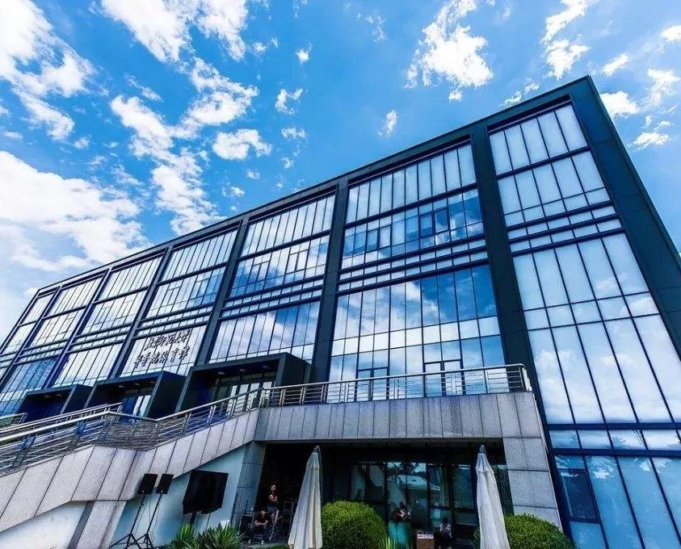
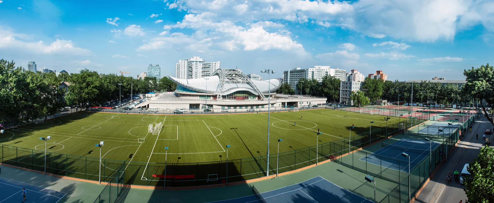

# 北京理工大学<br>学术答辩主题

<!-- 欢迎使用北理工 Slidev 主题。方向键翻页，P 进入演讲者视图，O 查看总览。 -->

---
layout: toc
---

1. [设计与版式](3)
2. [学术表达](8)
3. [图文与数据](12)
4. [写作与分享](17)

---
layout: section
number: '01'
subtitle: DESIGN & LAYOUTS
---

# 设计与版式

---
section: 设计与版式
sectionNumber: '01'
---

# 熟悉的北理工视觉语言

<p class="bit-lead">北理绿、褐红与留白，延续原模板的学术气质</p>

- 以原模板的校徽、校名和校园元素作为视觉基础
- 用统一的标题、章节页与页码组织报告
- 保留可编辑的文字、表格、公式和代码
- 适用于课程展示、组会汇报和学位论文答辩

<p class="bit-note">本项目为社区改编主题。原 PPT 设计：韩宇，北京理工大学光电学院，2019 年 5 月。</p>

---
layout: cover
variant: green
presenter: 北小理
advisor: 京小工
date: 2026 年 10 月
school: 学位论文答辩
subtitle: THESIS DEFENSE
---

# 纯绿封面<br>简洁而庄重

---
layout: cover
variant: photo
presenter: 北小理
advisor: 京小工
date: 2026 年 10 月
school: 课题组学术报告
subtitle: RESEARCH PRESENTATION
---

# 校园照片封面

---
layout: cover
variant: panorama
presenter: 北小理
advisor: 京小工
date: 2026 年 10 月
subtitle: BEIJING INSTITUTE OF TECHNOLOGY
---

# 全景封面 · 开阔的表达

---
layout: section
variant: light
number: '02'
subtitle: ACADEMIC EXPRESSION
---

# 学术表达

---
layout: two-cols
section: 学术表达
sectionNumber: '02'
---

# 两栏比较，同页展开

::left::

## 研究问题

研究报告需要说明问题的背景，以及现有方法的局限。

- 研究对象与适用范围
- 现有工作及其不足
- 本研究关注的具体问题

::right::

## 研究方法

方法部分需要给出可复现的步骤，并解释设计选择。

- 明确输入、输出与假设
- 交代实验设置和评价指标
- 说明验证方式与局限

---
section: 学术表达
sectionNumber: '02'
---

# 数学公式与代码

经验风险最小化的常见表达：

$$
\theta^* = \arg\min_{\theta}\; \frac{1}{N}\sum_{i=1}^{N}\mathcal{L}\bigl(f_{\theta}(x_i), y_i\bigr)
$$

```python
def empirical_risk(model, samples, loss):
    errors = [loss(model(x), y) for x, y in samples]
    return sum(errors) / len(errors)
```

<p class="bit-note">公式用于展示排版。代码省略了空样本等工程处理。</p>

---
layout: quote
author: 原 PPT 模板中的引文 · 徐特立
section: 学术表达
sectionNumber: '02'
---

实事求是，不自以为是。

---
layout: image-right
section: 图文与数据
sectionNumber: '03'
caption: 校园建筑照片，取自原 PPT 模板
---

## 图文并置

图片用于说明研究对象、实验设备或系统结构，文字补充图中无法直接读出的信息。

- 原始比例展示，避免裁掉图中证据
- 使用图注记录来源和观察条件
- 用少量文字说明重点

::title::

# 一张图，一段清晰的说明

::image::



---
layout: image-left
section: 图文与数据
sectionNumber: '03'
caption: 校园全景，取自原 PPT 模板
---

## 左图右文

通过命名插槽放置本地图片，无需额外编写页面样式。

默认完整显示图片。装饰照片可通过 `fit: cover` 选择裁切填充。

::title::

# 图文版式也支持反向排列

::image::



---
section: 图文与数据
sectionNumber: '03'
headerStyle: building
---

# 表格中的实验设置

| 项目 | 基线方法 | 改进方法 |
| --- | --- | --- |
| 数据划分 | 相同训练集与测试集 | 相同训练集与测试集 |
| 训练策略 | 固定学习率 | 学习率衰减 |
| 对比维度 | 准确率、计算成本 | 准确率、计算成本 |
| 复现信息 | 参数、环境、随机种子 | 参数、环境、随机种子 |

<p class="bit-note">示例说明如何组织对照实验，不代表真实实验结果。页眉可切换为原模板建筑插画风格。</p>

---
section: 图文与数据
sectionNumber: '03'
---

# 数据图表

<BitBarChart :items="[{ label: '基线方法', value: 72 }, { label: '改进方法 A', value: 81 }, { label: '改进方法 B', value: 88, accent: true }]" :max="100" unit="%" label="演示用准确率对比">
  演示数据，仅展示图表样式，不代表真实研究结论。
</BitBarChart>

<BitCallout title="结果解读">除平均指标外，报告样本量、误差范围和实验条件。</BitCallout>

---
section: 图文与数据
sectionNumber: '03'
headerStyle: minimal
---

# 研究计划与进度

<BitTimeline :items="[
  { date: '第一阶段', title: '文献调研', description: '界定研究问题，梳理已有方法与评价方式。' },
  { date: '第二阶段', title: '方法设计', description: '提出方案，确定实验条件与对照设置。' },
  { date: '第三阶段', title: '实验验证', description: '记录结果，完成消融实验与误差分析。' },
  { date: '第四阶段', title: '论文写作', description: '整理证据与复现材料，讨论研究局限。' }
]" />

---
layout: section
number: '04'
subtitle: WRITING & SHARING
---

# 写作与分享

---
section: 写作与分享
sectionNumber: '04'
---

# Markdown 与 AI 协作

1. 在 `slides.md` 填写研究问题、方法和已经核实的结果
2. 将 `docs/AI_PROMPT.md` 与材料一起交给 AI，生成初稿
3. 在浏览器中检查布局、数据来源与讲述顺序
4. 导出 PDF，或将网页部署后分享链接

<BitCallout title="人工核对">AI 生成的引用、数字和结论需要回到原始材料逐项验证。缺失的信息应保留为“待补充”。</BitCallout>

---
layout: figure
section: 写作与分享
sectionNumber: '04'
caption: 示例大图页，图片来自原 PPT 模板
---

# 大图与图注

::figure::


---
layout: center
section: 写作与分享
sectionNumber: '04'
---

# 参考资料与项目来源

[Slidev 官方文档](https://sli.dev)　[项目源码](https://github.com/RoxyXu151/slidev-theme-bit)

<p class="bit-note">视觉来源：韩宇《北京理工大学学术答辩 PPT 模板正式版》，2019 年 5 月 10 日。<br>主题代码采用 MIT 许可，原模板素材的权利说明见 NOTICE.md。</p>

---
layout: end
variant: green
presenter: 北小理
advisor: 京小工
subtitle: THANK YOU
---

# 感谢各位老师<br>敬请批评指正
